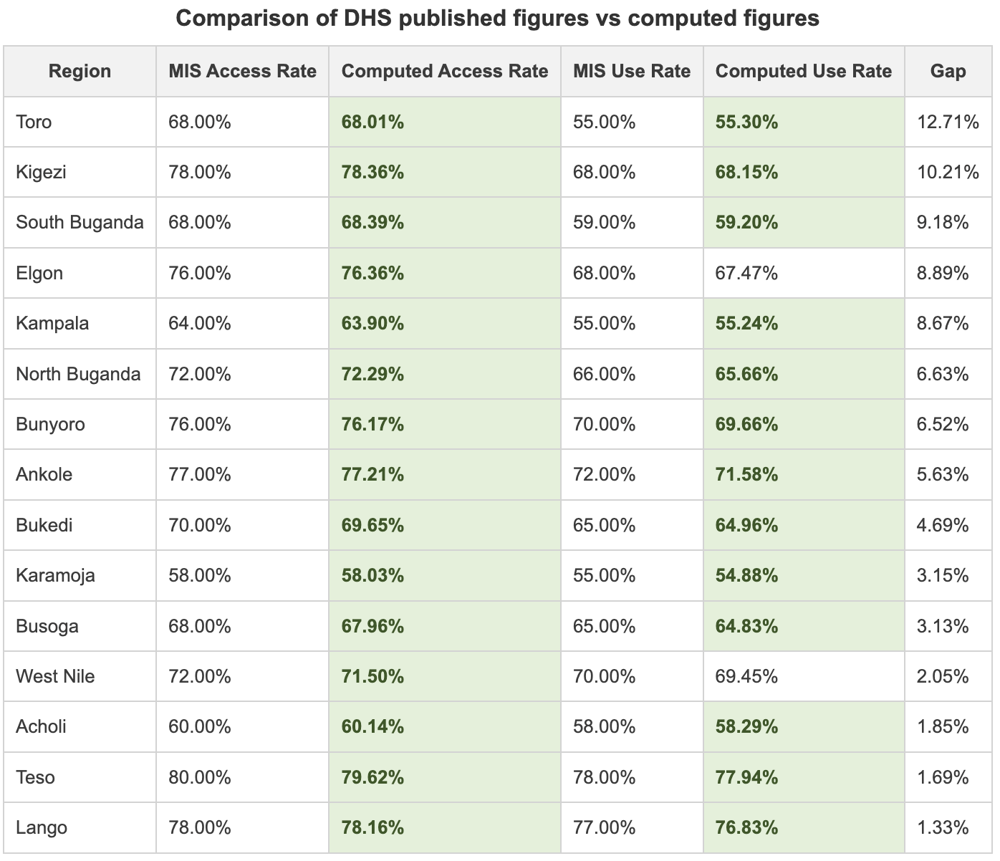

# DHS Malaria Indicator Survey ITN Access and Use Analysis
This repo analyzes the 2024-2025 DHS Malaria Inidicator Survey (MIS) to identify the rates of ITN access and usage by region. 

## Overview
This repo replicates sub-regional estimates of insecticide-treated net (ITN) access and use from Uganda's 2024-25 Malaria Indicator Survey, computed from raw DHS microdata. Across all 15 sub-regions, ITN access exceeds use, meaning more people had access to a net in their household than slept under one the night before the survey. The gap ranges from 13 percentage points in Toro to 1 point in Lango. All 30 estimates match the published MIS values within one percentage point. 

 

## Data
DHS data is available from [the DHS website](https://dhsprogram.com/Data/) for free following registration. Within the Uganda 2024-2025 DHS-9 MIS data, the following datasets are used by this analysis:

- Household Member Recode (Stata datset) = `UGPR91DT.ZIP`
- Household Recode (State dataset) = `UGHR91DT.ZIP`
- Geographic dataset (Shp file) = `UGGE91FL.ZIP`

Note: `data/raw/` is git ignored due to DHS terms that prohibit redistribution of microdata.  

## Setup

```
pip install -r requirements.txt
```

## Project Structure

```
├── data/
│   ├── raw/              # DHS microdata (gitignored)
│   └── processed/        # cleaned output CSVs
├── python/
│   └── 01_analysis.ipynb
├── .gitignore
├── README.md
└── requirements.txt
```

## License
MIT
